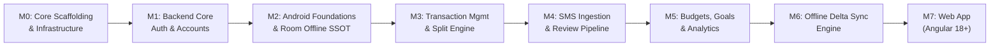

# Development Log

> Reverse-chronological log of significant changes, decisions, and milestones.  
> Add an entry for every PR or notable session.

---

## Format

```
## YYYY-MM-DD — <Short Title>
**Author:** <name or alias>
**Scope:** android | backend | web | docs | infra | all

### What changed
- Bullet points describing what was done.

### Decisions made
- Any architectural or design decisions taken and the reasoning.

### Next steps
- What comes next.
```

---

## 2026-11-18 — Authentication & User Management Implementation

**Author:** Backend Engineer & Software Architect  
**Scope:** backend | auth | users

### What changed
- Implemented `User` model in `app/modules/users/models.py` with unique case-insensitive email indexing, bcrypt password hashing, base currency, and timestamp mixins.
- Implemented `RefreshToken` model in `app/modules/auth/models.py` supporting token family rotation (`family_id`), SHA-256 token hash storage, and explicit revocation.
- Built `app/core/security.py` with bcrypt password hashing (12 rounds), JWT access token generation (15 min lifespan), and cryptographically secure opaque refresh tokens.
- Implemented `AuthService` in `app/modules/auth/service.py` for user registration, authentication, refresh token rotation with token reuse detection, and session revocation.
- Implemented `UserService` in `app/modules/users/service.py` with email uniqueness enforcement, profile retrieval, and profile updates.
- Added OAuth2 Bearer token dependency in `app/api/deps.py` (`get_current_user`, `get_current_active_user`) providing protected endpoint authorization and cross-user data isolation.
- Built REST API endpoints for `auth` (`POST /api/v1/auth/register`, `POST /api/v1/auth/login`, `POST /api/v1/auth/refresh`, `POST /api/v1/auth/logout`) and `users` (`GET /api/v1/users/me`, `PATCH /api/v1/users/me`).
- Added Alembic migration `0002_create_users_and_refresh_tokens.py` with transactional DDL and composite indexes.
- Added 13 automated tests in `tests/test_auth.py` and `tests/test_users.py` bringing the test suite to 36 passing tests.

### Decisions made
- **Token Family Rotation & Reuse Detection:** Every refresh token exchange marks the previous token as consumed and issues a new pair sharing the same `family_id`. If an already-revoked refresh token is re-submitted (indicating token theft or replay), all tokens in that family are immediately revoked.
- **Hashed Refresh Token Storage:** Refresh tokens are generated as 48-byte URL-safe strings; only their SHA-256 hash is persisted in the database.
- **Strict Data Isolation:** Endpoints such as `/users/me` strictly resolve data for `current_user` extracted from the cryptographically verified JWT subject, preventing unauthorized access across users.

### Next steps
- Implement Account Management (Bank accounts, Credit cards, UPI wallets, Cash) with balance adjustments and transfers.

---

## 2026-11-17 — Backend Foundation & Infrastructure Scaffolding

**Author:** Backend Engineer & Software Architect  
**Scope:** backend | infra

### What changed
- Scaffolded modular monolith architecture under `backend/app/modules/` with 9 isolated domain packages: `auth`, `users`, `accounts`, `transactions`, `categories`, `split_expenses`, `settlements`, `budgets`, and `analytics`.
- Implemented centralized, environment-driven Pydantic v2 configuration in `app/core/config.py` with dynamic URL computation, connection pooling, and CORS origin list parsing.
- Implemented structured JSON logging in `app/core/logging.py` featuring a strict `PIIFilter` that redacts passwords, tokens, auth headers, and credit card numbers.
- Implemented global domain exceptions and RFC 7807-compliant HTTP exception handlers in `app/core/exceptions.py`.
- Implemented `/health` and `/health/db` health-check endpoints in `app/core/health.py` with connection latency measurement and 503 fallback handling.
- Set up SQLAlchemy 2.0 async engine and session management in `app/db/session.py` with `TimestampMixin`, `SoftDeleteMixin`, and `UUIDPrimaryKeyMixin` in `app/db/base.py`.
- Initialized Alembic with async template support, environment variable loading in `alembic/env.py`, and created `0001_initial_baseline` revision.
- Created multi-stage `backend/Dockerfile` and root/backend `docker-compose.yml` orchestrating FastAPI backend and PostgreSQL 16 Alpine.
- Built comprehensive Pytest test suite with 23 passing tests covering app startup, health endpoints, Pydantic settings, exception envelopes, and module status endpoints.

### Decisions made
- **Modular Monolith Packages (`app/modules/`):** Each module encapsulates its own router, service, schemas, and models to maintain clean separation of concerns and prevent cross-boundary leaks before domain features are added.
- **Dynamic Database Driver URLs:** `Settings.async_database_url` defaults to `asyncpg` for high-throughput async FastAPI operations, while `Settings.sync_database_url` strips the async driver for sync database tooling.
- **Strict PII Redaction at Filter Level:** Zero PII is written to console or logs by intercepting all log records through `PIIFilter` before stream formatting.

### Next steps
- Implement Milestone 1: Concrete SQLAlchemy models, schemas, and service logic for Auth (JWT token rotation) and Accounts (Bank, Credit Card, Cash, UPI).

---

## 2026-11-16 — Comprehensive Technical Architecture & Phased Blueprint

**Author:** Senior Software Architect  
**Scope:** docs | all

### What changed
- Completely revised and expanded `docs/REQUIREMENTS.md` with complete functional specifications for Axio-style SMS parsing, split expense accounting, multi-account tracking, offline-first sync, budgets, savings goals, recurring rules, and NFRs.
- Authored `docs/ARCHITECTURE.md` detailing the multi-platform topology (Android Clean Architecture/MVVM + Room SSOT, FastAPI Modular Monolith, Angular 18+ Web), end-to-end Mermaid sequence diagrams for SMS capture, split settlement, offline delta sync, and zero-PII security.
- Authored `docs/DATABASE_SCHEMA.md` with full PostgreSQL 16 table specifications, constraints, `NUMERIC(14,2)` precision, client UUIDv7 keys, indexes, tombstones, and local encrypted Room schema.
- Authored `docs/API_CONTRACT.md` specifying all v1 REST endpoints including JWT family rotation, Accounts, Transactions, Splits, Settlements, Budgets, Analytics, and Delta Sync (`/push` and `/pull`).
- Defined the phased implementation milestones (M0 through M7) with dependencies and strict acceptance criteria.
- Formulated the comprehensive testing strategy covering unit, integration, and UI testing across platforms.

### Architectural Decisions & Rationale
1. **Separation of Personal Expense vs Gross Transaction:**
   - *Problem:* Splitting a ₹2,000 bill with 3 friends often causes personal finance apps to record ₹2,000 as personal expense, or mistakenly record a friend's ₹500 repayment as "income".
   - *Decision:* Maintain the gross bank transaction intact (`amount = 2000.00`) for account balance reconciliation, but explicitly isolate `personal_amount = 500.00` for budget and expense reporting. Friend shares are ledgered as `ACCOUNTS_RECEIVABLE`. Settlements reduce debt without counting as income.
2. **On-Device Local SMS Parsing & Zero Cloud Upload:**
   - *Problem:* Uploading raw SMS text to backend servers violates privacy expectations and risks leaking sensitive OTPs or personal messages.
   - *Decision:* All SMS parsing is strictly performed on the Android device via a modular regex/heuristic engine. Only structured, user-confirmed transaction data synchronizes to the cloud. Raw SMS text never touches the network.
3. **Google Play Store Policy Decoupling:**
   - *Problem:* Google Play strictly restricts `RECEIVE_SMS` / `READ_SMS` permissions.
   - *Decision:* Ingestion is abstracted behind an `SmsIngestionSource` interface. Development and initial phases rely on a synthetic SMS test suite and manual paste / file import. If production Play Store exemptions are denied, the app gracefully falls back to an Android Notification Listener service or manual transaction capture.
4. **Offline-First Delta Synchronization with UUIDv7:**
   - *Problem:* Auto-incrementing integer IDs require server round-trips before saving offline records, causing blocking or collision bugs.
   - *Decision:* All entities use UUIDv7 generated on the client. Synchronization operates via high-watermark timestamp exchange (`/sync/push` and `/sync/pull`), utilizing soft-deletes and tombstones. Conflict resolution defaults to Last-Write-Wins (LWW) with immutable settlement logs.
5. **Monetary Precision Guarantee:**
   - *Problem:* Floating-point data types (`float`, `double`) introduce rounding drift over time.
   - *Decision:* `NUMERIC(14, 2)` enforced in PostgreSQL, `BigDecimal` in Kotlin, `Decimal` in Python, and fixed-point 2-decimal strings in REST payloads.

---

### Phased Development Roadmap



#### Milestone Details & Acceptance Criteria

| Milestone | Scope | Deliverables | Acceptance Criteria |
|---|---|---|---|
| **M0: Scaffolding & Infra** | Infra, Backend, Android | Docker Compose setup (PostgreSQL 16), Python virtualenv with FastAPI skeleton & Alembic, Android Studio project scaffold (Hilt, Compose, Room, Detekt/Ktlint). | `docker compose up` starts Postgres & healthy FastAPI; Android builds cleanly with Hilt. |
| **M1: Backend Auth & Accounts** | Backend | User auth (Argon2id/bcrypt, JWT access + refresh rotation), Account CRUD, Category endpoints, Alembic initial migration, Pytest suite. | ≥ 80% coverage on `auth` and `accounts` services; refresh token reuse triggers family revocation. |
| **M2: Android DB & Offline SSOT** | Android | Room DB schema (SQLCipher encrypted), Room DAOs, DataStore for auth tokens, Hilt DI graph, Navigation scaffolding, Accounts list & create screens. | Local account creation works 100% offline; Room migrations tested; encrypted DB unlocks via Keystore. |
| **M3: Transactions & Split Ledger** | Android & Backend | Transaction CRUD (income, expense, transfer), Friends directory, Split bill engine (Equal, Exact, Percentage), Settlements ledger. | Splitting ₹2,000 for 4 people sets personal expense to ₹500 and Rahul's receivable to ₹500; settling ₹500 does not count as income; unit tests verify zero rounding loss. |
| **M4: On-Device SMS Parser** | Android | SMS BroadcastReceiver, modular Bank Regex parser (HDFC, SBI, ICICI, Axis, UPI), deduplication engine, Pending Review queue UI & actionable notifications. | 100% pass rate on synthetic SMS test corpus (50+ diverse bank formats); raw SMS never leaves device; duplicate SMS within 15 mins rejected. |
| **M5: Budgets, Goals & Analytics** | Android & Backend | Category budget tracker with warning thresholds, Savings goals with progress contributions, Dashboard rollups (Net Worth, Burn Rate, Category charts). | Budget alerts trigger at 80% and 100%; net worth accurately calculates liquid assets minus credit debt; Compose charts render smoothly. |
| **M6: Two-Way Delta Sync** | Android & Backend | FastAPI `/sync/push` & `/sync/pull` endpoints, Android WorkManager periodic sync worker, tombstone deletion propagation, conflict resolution. | Transactions created offline sync cleanly when network reconnects; simultaneous edits resolve via LWW; deleted records propagate across clients. |
| **M7: Angular Web Application** | Web | Angular 18 standalone components, Tailwind CSS styling, JWT auth interceptor, Dashboard analytics with ECharts, Transaction and Account management. | Desktop web app displays real-time synced data from backend; responsive on mobile/desktop; passes WCAG 2.1 AA accessibility checks. |

---

### Testing Strategy

1. **Unit Testing:**
   - **Backend:** `pytest` testing services, domain calculations, JWT token lifecycle, and Pydantic validation. Target: ≥ 80% coverage.
   - **Android:** JUnit 5 + MockK testing ViewModels, Use Cases, Split calculations, and SMS parsing against a synthetic corpus of 50+ bank SMS variations.
2. **Integration Testing:**
   - **Backend:** `pytest` + `httpx.AsyncClient` executed against a live PostgreSQL 16 container (via testcontainers or docker-compose). No mocked databases.
   - **Android:** Room in-memory database tests asserting DAOs, foreign keys, cascade deletes, and migrations.
3. **End-to-End & UI Testing:**
   - **Android:** Compose UI tests using `createAndroidComposeRule` testing critical flows (create transaction ➔ split with friend ➔ settle).
   - **Web:** Jasmine/Karma unit tests + Playwright E2E smoke tests.

---

### Next Immediate Steps
1. Update `README.md` to reflect the comprehensive architecture, technology stack, and milestone roadmap.
2. Scaffold Milestone 0: Initialize Docker Compose, FastAPI project skeleton, and Android Gradle configuration.

---

## 2026-11-16 — Repository Bootstrap

**Author:** Initial Setup  
**Scope:** all

### What changed
- Initialized Git repository.
- Created monorepo folder structure: `android/`, `backend/`, `web/`, `docs/`.
- Added placeholder documentation: `REQUIREMENTS.md`, `ARCHITECTURE.md`, `DATABASE_SCHEMA.md`, `API_CONTRACT.md`.
- Added `AGENTS.md` with AI coding guidelines and project conventions.
- Added `.gitignore` for Kotlin/Android, Python/FastAPI, Angular, and IDE files.
- Added root `README.md`.
