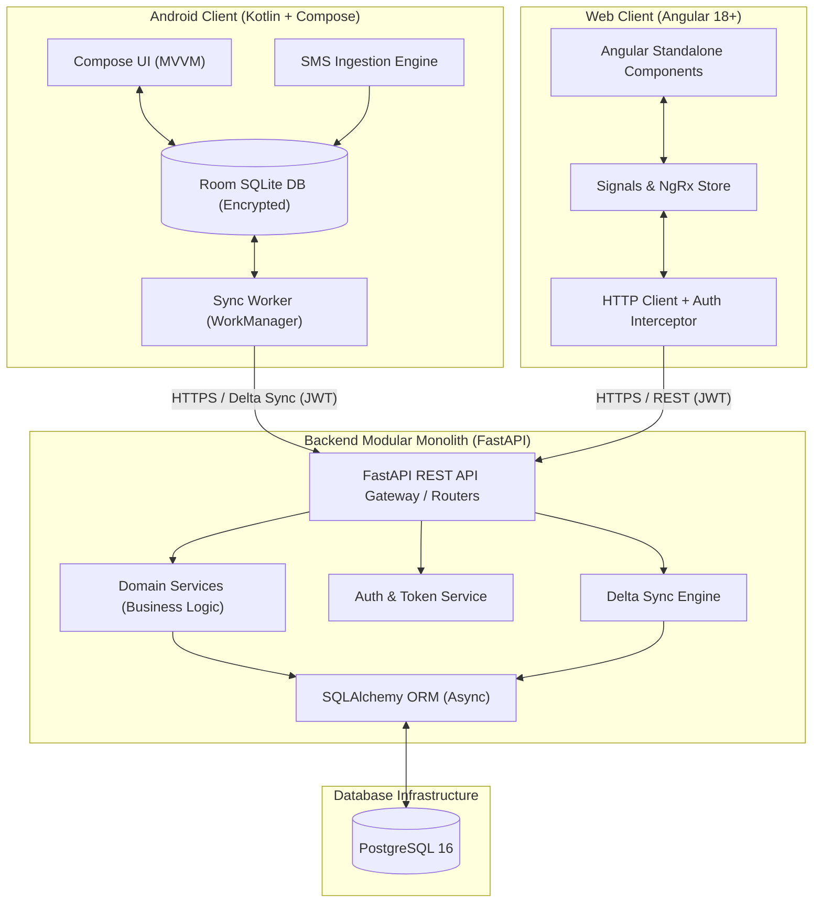
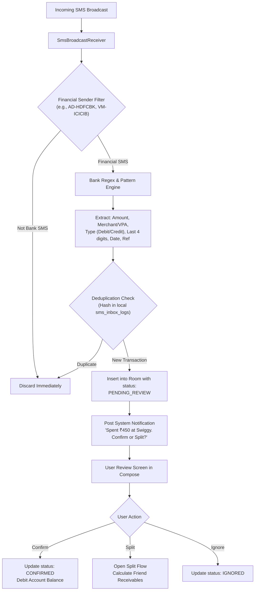
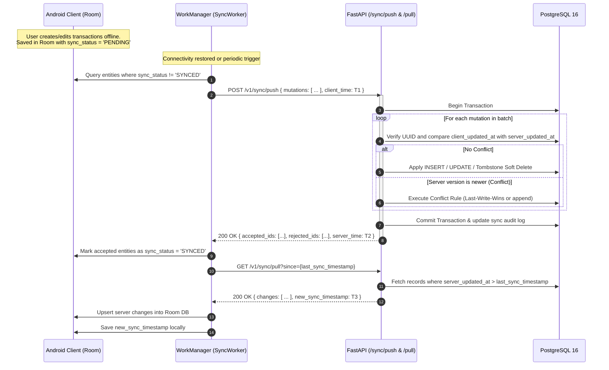
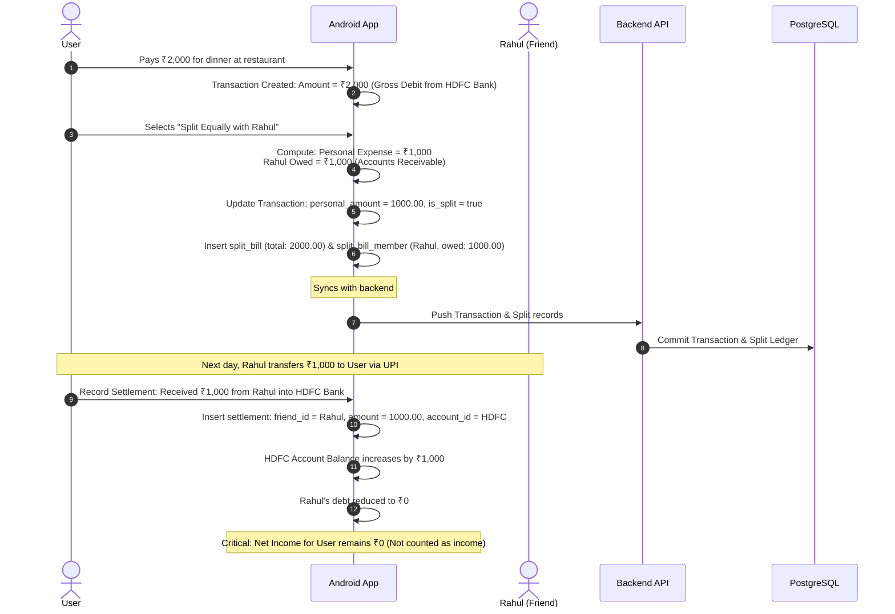

# System Architecture & Technical Design

> **Project:** Personal Finance Tracker  
> **Status:** Approved Architecture Blueprint  
> **Last Updated:** 2026-11-16  

---

## 1. High-Level System Overview

The system is designed as an **offline-first, multi-platform personal finance ecosystem** anchored by a central stateless **FastAPI backend**, an **Android client** acting as the primary transactional ingestion point, and a responsive **Angular web client** for desktop review and analytics.



---

## 2. Android Client Architecture

The Android application strictly implements **MVVM with Clean Architecture** and treats the local Room database as the immutable **Single Source of Truth (SSOT)**.

```mermaid
flowchart LR
    subgraph Presentation["Presentation Layer (Jetpack Compose)"]
        Screens["Compose Screens / NavHost"]
        VMs["ViewModels (StateFlow / UI State)"]
        Screens <--> VMs
    end

    subgraph Domain["Domain Layer (Pure Kotlin)"]
        UseCases["Use Cases / Interactors"]
        DomainModels["Domain Entities"]
        RepoInterfaces["Repository Interfaces"]
        VMs --> UseCases
        UseCases --> RepoInterfaces
        UseCases -.-> DomainModels
    end

    subgraph Data["Data Layer (Android & Room)"]
        RepoImpl["Repository Implementations"]
        LocalDS["Local Data Source (Room DAOs)"]
        RemoteDS["Remote Data Source (Retrofit)"]
        RoomDB[("Room Database (SQLCipher)")]
        API["Backend REST API"]
        
        RepoInterfaces <|-- RepoImpl
        RepoImpl <--> LocalDS
        RepoImpl <--> RemoteDS
        LocalDS <--> RoomDB
        RemoteDS <--> API
    end
```

### 2.1 Android Package Structure
```
android/app/src/main/java/com/financetracker/
├── core/
│   ├── common/             # Result wrappers, Dispatchers, Extensions, Constants
│   ├── database/           # Room DB instance, Entities, DAOs, TypeConverters
│   ├── datastore/          # EncryptedSharedPreferences / DataStore for tokens & prefs
│   ├── network/            # Retrofit instances, AuthInterceptor, NetworkBoundResource
│   ├── model/              # Shared domain models (Money, Currency, CategoryType)
│   └── sms/                # SMS parsing engine, bank regexes, deduplicator
├── di/                     # Hilt Dependency Injection modules
├── domain/
│   ├── usecase/
│   │   ├── transaction/    # GetTransactions, SaveTransaction, SplitTransaction
│   │   ├── split/          # CalculateSplitShares, SettleDebt
│   │   ├── account/        # ReconcileAccountBalance, TransferFunds
│   │   ├── budget/         # EvaluateBudgetStatus
│   │   └── sync/           # PerformDeltaSyncUseCase
│   └── repository/         # Repository contracts
├── data/
│   ├── repository/         # TransactionRepositoryImpl, AccountRepositoryImpl, etc.
│   └── sync/               # SyncManager, SyncWorker, SyncConflictResolver
└── presentation/
    ├── navigation/         # NavGraph, Destinations, BottomBar
    ├── theme/              # Material 3 Color Schemes, Typography, Shapes
    ├── components/         # Reusable Compose widgets (CurrencyText, CategoryIcon, FilterChip)
    ├── dashboard/          # DashboardScreen, DashboardViewModel
    ├── transactions/       # TransactionListScreen, TransactionDetailScreen, AddEditScreen
    ├── split/              # SplitExpenseScreen, FriendsListScreen, SettlementScreen
    ├── accounts/           # AccountListScreen, AccountDetailScreen
    ├── budgets/            # BudgetOverviewScreen, AddBudgetDialog
    ├── review/             # PendingSmsReviewScreen, SmsDetailReviewDialog
    └── analytics/          # SpendingChartsScreen, CategoryDrillDownScreen
```

### 2.2 SMS Ingestion Subsystem (On-Device)
The SMS subsystem operates autonomously without requiring backend network availability:



---

## 3. Backend Architecture (FastAPI Modular Monolith)

The backend follows a **Stateless Modular Monolith** pattern. Routers remain thin, delegating all domain logic and invariants to the service layer.

### 3.1 Backend Module Hierarchy
```
backend/
├── app/
│   ├── api/
│   │   ├── v1/
│   │   │   ├── router.py           # Master v1 router aggregating feature endpoints
│   │   │   ├── auth.py             # Login, register, refresh, logout
│   │   │   ├── accounts.py         # Account CRUD, balance adjustments
│   │   │   ├── transactions.py     # Transaction CRUD, transfers
│   │   │   ├── splits.py           # Split bills, friends, settlements
│   │   │   ├── categories.py       # Default and custom categories
│   │   │   ├── budgets.py          # Category budgets, threshold checks
│   │   │   ├── goals.py            # Savings goals, progress contributions
│   │   │   ├── recurring.py        # Subscription and bill recurrence rules
│   │   │   ├── analytics.py        # Dashboard rollups, category breakdowns, trends
│   │   │   └── sync.py             # Delta sync: /push and /pull
│   │   └── deps.py                 # Dependency injection: get_current_user, get_db
│   ├── core/
│   │   ├── config.py               # Pydantic BaseSettings (env vars)
│   │   ├── security.py             # Password hashing (Argon2id/bcrypt), JWT encode/decode
│   │   ├── exceptions.py           # Domain exceptions & RFC 7807 problem handlers
│   │   └── logging.py              # Structured JSON logging (zero PII)
│   ├── models/                     # SQLAlchemy 2.0 async ORM models
│   │   ├── user.py
│   │   ├── account.py
│   │   ├── category.py
│   │   ├── transaction.py
│   │   ├── split.py
│   │   ├── budget.py
│   │   ├── goal.py
│   │   ├── recurring.py
│   │   └── sync_audit.py
│   ├── schemas/                    # Pydantic v2 validation models
│   │   ├── auth.py
│   │   ├── account.py
│   │   ├── transaction.py
│   │   ├── split.py
│   │   ├── budget.py
│   │   ├── analytics.py
│   │   └── sync.py
│   ├── services/                   # Encapsulated Business Logic (Strictly No DB calls in Routers)
│   │   ├── auth_service.py
│   │   ├── account_service.py
│   │   ├── transaction_service.py
│   │   ├── split_service.py
│   │   ├── budget_service.py
│   │   ├── analytics_service.py
│   │   └── sync_service.py
│   ├── db/
│   │   ├── session.py              # Async engine and sessionmaker
│   │   └── base.py                 # Base declarative model
│   └── main.py                     # App factory, CORS, exception handlers, telemetry
├── alembic/                        # Database migration scripts
├── tests/
│   ├── unit/                       # Business logic unit tests
│   └── integration/                # Full API async tests with test PostgreSQL
├── Dockerfile
└── docker-compose.yml
```

---

## 4. Web Application Architecture (Angular 18+)

The Web application is structured for desktop and tablet users who require large-screen financial reports, data export, and manual transaction review:
- **Standalone Components:** No `NgModule` boilerplate; lazy-loaded feature routes.
- **Signals + RxJS:** Angular Signals for local component reactivity; RxJS for complex asynchronous streams and HTTP pipelines.
- **NgRx Store / SignalStore:** Centralized state management for accounts, active filters, and cached financial summaries.
- **Styling & UI:** Tailwind CSS for layout utility; Spartan UI / Angular Material for accessible UI primitives; Apache ECharts for rendering smooth time-series graphs and categorical sunburst/donut charts.
- **HTTP Interceptor:** Transparent JWT bearer attachment, proactive token refresh upon receiving 401 Unauthorized, and graceful redirect to login.

---

## 5. Offline-First & Bidirectional Synchronization Strategy

To guarantee continuous usability without internet connectivity, the system uses a **Timestamped Delta Synchronization Engine** with client-side UUIDv7 generation.



### 5.1 UUIDv7 Primary Keys
All entities use **UUIDv7** (time-ordered UUIDs) generated on the client. This guarantees:
- Zero ID collisions between offline Android records and server records.
- Sequential B-tree indexing in PostgreSQL and SQLite, preventing database page fragmentation.

### 5.2 Conflict Resolution Invariants
1. **LWW (Last-Write-Wins):** For standard entities (Account name, Category color, Transaction note), the record with the most recent `updated_at` timestamp takes precedence.
2. **Immutable Financial Events for Splits:** Split settlements and debt payments are recorded as immutable transaction logs rather than mutable balance overrides. Adding a settlement appends a row to `settlements`, ensuring concurrent updates from different devices never overwrite each other.
3. **Soft Deletion & Tombstones:** Deleted entities set `is_deleted = TRUE` and retain `updated_at = now()`. A dedicated `sync_tombstones` table guarantees that devices that have been offline for weeks still receive deletion updates.

---

## 6. End-to-End Data Flow Scenarios

### 6.1 Scenario 1: Expense Splitting Financial Flow



---

## 7. Security, Privacy & Integrity Architecture

| Security Domain | Architectural Implementation |
|---|---|
| **Data at Rest (Android)** | Local Room DB encrypted via **256-bit SQLCipher**. Passphrase derived securely from the Android Keystore. |
| **Data in Transit** | **TLS 1.3** required on all endpoints. Android network security configuration enforces strict domain certificates. |
| **Authentication** | **JWT with Refresh Token Family Rotation**: Short-lived access token (15 mins) and cryptographically random, hashed refresh token (7 days). If a compromised refresh token is reused, the entire token family is immediately revoked. |
| **SMS Data Sovereignty** | **Zero raw SMS leaves the device.** Regex extraction occurs exclusively in the Android process space. SMS strings are zeroed out in memory after parsing. |
| **Monetary Precision** | All monetary amounts stored as `NUMERIC(14, 2)` in PostgreSQL and mapped to `BigDecimal` in Kotlin / `Decimal` in Python. Floating-point types are strictly forbidden. |
| **PII & Log Sanitization** | Structured loggers filter and mask email addresses, names, card numbers, and tokens. |

---

## 8. Deployment & DevOps Architecture

### 8.1 Local & Development Topology
```yaml
# docker-compose.yml structure
services:
  db:
    image: postgres:16-alpine
    environment:
      POSTGRES_DB: financetracker
      POSTGRES_USER: ${DB_USER}
      POSTGRES_PASSWORD: ${DB_PASSWORD}
    volumes:
      - pgdata:/var/lib/postgresql/data
    ports:
      - "5432:5432"

  backend:
    build: ./backend
    command: uvicorn app.main:app --host 0.0.0.0 --port 8000 --reload
    environment:
      DATABASE_URL: postgresql+asyncpg://${DB_USER}:${DB_PASSWORD}@db:5432/financetracker
      SECRET_KEY: ${SECRET_KEY}
    ports:
      - "8000:8000"
    depends_on:
      - db

  web:
    build: ./web
    ports:
      - "4200:80"
```

### 8.2 Production Deployment Path
- **Backend:** Containerized FastAPI app served via Uvicorn behind an Nginx reverse proxy providing automated Let's Encrypt SSL termination.
- **Database:** Managed PostgreSQL instance with automated daily snapshots and write-ahead log (WAL) archiving.
- **Android CI/CD:** GitHub Actions workflow running `./gradlew test` (unit tests), `ktlintCheck`, and producing unsigned APKs / release AABs.
- **Backend CI/CD:** GitHub Actions workflow running `ruff` linting, `mypy` type validation, and `pytest` with a live PostgreSQL service container.
