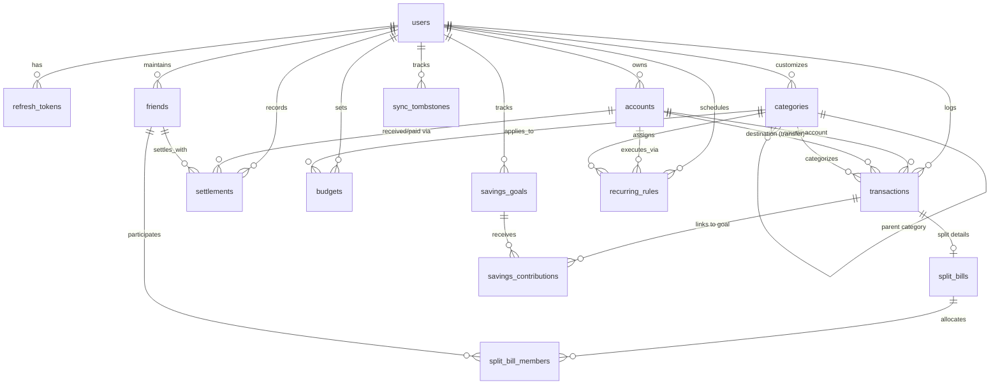

# Database Schema & Data Models

> **Project:** Personal Finance Tracker  
> **Status:** Approved Architecture Blueprint  
> **Last Updated:** 2026-11-16  
> **Primary Engine:** PostgreSQL 16 (Server) & Room / SQLite 3.35+ (Android Client)

---

## 1. Entity-Relationship Diagram (ERD)



---

## 2. Global Design Conventions & Constraints

1. **Primary Keys:** Every entity uses a client-generated **UUIDv7** (stored as `UUID` in PostgreSQL and `String` or 16-byte `ByteArray` in SQLite). UUIDv7 provides natural time-ordering and prevents index fragmentation.
2. **Monetary Precision:** All amounts are defined as **`NUMERIC(14, 2)`** with explicit `CHECK (amount >= 0)` constraints. Floating-point arithmetic (`FLOAT`, `DOUBLE`) is strictly prohibited.
3. **Auditing & Sync Fields:** Every synchronized table includes:
   - `created_at TIMESTAMPTZ NOT NULL DEFAULT now()`
   - `updated_at TIMESTAMPTZ NOT NULL DEFAULT now()`
   - `is_deleted BOOLEAN NOT NULL DEFAULT FALSE`
   - `deleted_at TIMESTAMPTZ NULL`
4. **Foreign Key Integrity:** All multi-tenant tables enforce an explicit `user_id UUID NOT NULL REFERENCES users(id) ON DELETE CASCADE`.

---

## 3. PostgreSQL Table Definitions

### 3.1 `users`
Core user identity and application preferences.

| Column | Type | Constraints | Description |
|---|---|---|---|
| `id` | `UUID` | `PRIMARY KEY` | Unique User UUIDv7 |
| `email` | `VARCHAR(255)` | `UNIQUE NOT NULL` | Verified login email |
| `hashed_password` | `VARCHAR(255)` | `NOT NULL` | Argon2id / bcrypt password hash |
| `full_name` | `VARCHAR(150)` | `NOT NULL` | Display name |
| `base_currency` | `CHAR(3)` | `NOT NULL DEFAULT 'INR'` | ISO-4217 Currency Code |
| `is_active` | `BOOLEAN` | `NOT NULL DEFAULT TRUE` | Active account flag |
| `is_verified` | `BOOLEAN` | `NOT NULL DEFAULT FALSE` | Email verified flag |
| `created_at` | `TIMESTAMPTZ` | `NOT NULL DEFAULT now()` | Record creation timestamp |
| `updated_at` | `TIMESTAMPTZ` | `NOT NULL DEFAULT now()` | Last update timestamp |

---

### 3.2 `refresh_tokens`
Maintains active refresh token families for rotating JWT authentication.

| Column | Type | Constraints | Description |
|---|---|---|---|
| `id` | `UUID` | `PRIMARY KEY` | Token record UUID |
| `user_id` | `UUID` | `NOT NULL REFERENCES users(id) ON DELETE CASCADE` | Owner user |
| `token_hash` | `VARCHAR(64)` | `UNIQUE NOT NULL` | SHA-256 hash of refresh token |
| `family_id` | `UUID` | `NOT NULL` | Refresh token family for reuse detection |
| `expires_at` | `TIMESTAMPTZ` | `NOT NULL` | Expiration timestamp |
| `revoked` | `BOOLEAN` | `NOT NULL DEFAULT FALSE` | Explicit revocation status |
| `created_at` | `TIMESTAMPTZ` | `NOT NULL DEFAULT now()` | Issue timestamp |

---

### 3.3 `accounts`
Financial containers representing real-world bank accounts, cards, and wallets.

| Column | Type | Constraints | Description |
|---|---|---|---|
| `id` | `UUID` | `PRIMARY KEY` | Account UUIDv7 |
| `user_id` | `UUID` | `NOT NULL REFERENCES users(id) ON DELETE CASCADE` | Account owner |
| `name` | `VARCHAR(100)` | `NOT NULL` | e.g., "HDFC Salary Account", "Amazon Pay ICICI" |
| `account_type` | `VARCHAR(20)` | `NOT NULL CHECK (account_type IN ('BANK', 'CREDIT_CARD', 'CASH', 'UPI_WALLET'))` | Asset/Liability type |
| `institution_name` | `VARCHAR(100)` | `NULL` | Bank or issuer name (e.g., "HDFC Bank") |
| `account_number_suffix` | `VARCHAR(6)` | `NULL` | Last 4 digits (used for SMS pattern matching) |
| `currency` | `CHAR(3)` | `NOT NULL DEFAULT 'INR'` | ISO-4217 Currency Code |
| `current_balance` | `NUMERIC(14, 2)` | `NOT NULL DEFAULT 0.00` | Reconciled current balance |
| `credit_limit` | `NUMERIC(14, 2)` | `NULL CHECK (credit_limit >= 0)` | Total credit limit (for credit cards) |
| `billing_cycle_day` | `SMALLINT` | `NULL CHECK (billing_cycle_day BETWEEN 1 AND 31)` | Day of month statement is generated |
| `payment_due_day` | `SMALLINT` | `NULL CHECK (payment_due_day BETWEEN 1 AND 31)` | Day of month payment is due |
| `color_hex` | `CHAR(7)` | `NOT NULL DEFAULT '#2563EB'` | UI branding color hex (e.g., `#2563EB`) |
| `icon_name` | `VARCHAR(50)` | `NOT NULL DEFAULT 'account_balance'` | Material icon identifier |
| `is_archived` | `BOOLEAN` | `NOT NULL DEFAULT FALSE` | Hidden from daily views |
| `is_deleted` | `BOOLEAN` | `NOT NULL DEFAULT FALSE` | Soft delete marker |
| `created_at` | `TIMESTAMPTZ` | `NOT NULL DEFAULT now()` | Creation timestamp |
| `updated_at` | `TIMESTAMPTZ` | `NOT NULL DEFAULT now()` | Last update timestamp |

---

### 3.4 `categories`
Hierarchical spending and income categories.

| Column | Type | Constraints | Description |
|---|---|---|---|
| `id` | `UUID` | `PRIMARY KEY` | Category UUIDv7 |
| `user_id` | `UUID` | `NULL REFERENCES users(id) ON DELETE CASCADE` | NULL = System Default; User UUID = Custom |
| `parent_id` | `UUID` | `NULL REFERENCES categories(id) ON DELETE SET NULL` | Self-referencing FK for subcategories |
| `name` | `VARCHAR(100)` | `NOT NULL` | e.g., "Food & Dining", "Groceries", "Salary" |
| `category_type` | `VARCHAR(10)` | `NOT NULL CHECK (category_type IN ('EXPENSE', 'INCOME', 'TRANSFER'))` | High-level ledger type |
| `icon_name` | `VARCHAR(50)` | `NOT NULL DEFAULT 'category'` | Material symbol icon identifier |
| `color_hex` | `CHAR(7)` | `NOT NULL DEFAULT '#64748B'` | UI color hex |
| `is_system` | `BOOLEAN` | `NOT NULL DEFAULT FALSE` | System immutable category flag |
| `is_deleted` | `BOOLEAN` | `NOT NULL DEFAULT FALSE` | Soft delete marker |
| `created_at` | `TIMESTAMPTZ` | `NOT NULL DEFAULT now()` | Creation timestamp |
| `updated_at` | `TIMESTAMPTZ` | `NOT NULL DEFAULT now()` | Last update timestamp |

---

### 3.5 `transactions`
Core financial journal storing income, expense, and transfer movements.

| Column | Type | Constraints | Description |
|---|---|---|---|
| `id` | `UUID` | `PRIMARY KEY` | Transaction UUIDv7 |
| `user_id` | `UUID` | `NOT NULL REFERENCES users(id) ON DELETE CASCADE` | Transaction owner |
| `account_id` | `UUID` | `NOT NULL REFERENCES accounts(id) ON DELETE RESTRICT` | Primary / source account debited or credited |
| `to_account_id` | `UUID` | `NULL REFERENCES accounts(id) ON DELETE RESTRICT` | Destination account (only for `TRANSFER`) |
| `category_id` | `UUID` | `NULL REFERENCES categories(id) ON DELETE SET NULL` | Assigned spending or income category |
| `transaction_type` | `VARCHAR(10)` | `NOT NULL CHECK (transaction_type IN ('EXPENSE', 'INCOME', 'TRANSFER'))` | Direction of funds |
| `amount` | `NUMERIC(14, 2)` | `NOT NULL CHECK (amount > 0)` | **Gross** bank transaction amount |
| `personal_amount` | `NUMERIC(14, 2)` | `NOT NULL CHECK (personal_amount >= 0)` | **Net personal share** (Gross minus friends' split) |
| `currency` | `CHAR(3)` | `NOT NULL DEFAULT 'INR'` | Currency code |
| `transaction_date` | `TIMESTAMPTZ` | `NOT NULL` | Real-world date & time of transaction |
| `status` | `VARCHAR(20)` | `NOT NULL DEFAULT 'CONFIRMED' CHECK (status IN ('CONFIRMED', 'PENDING_REVIEW', 'DRAFT'))` | Confirmation state |
| `merchant_name` | `VARCHAR(150)` | `NULL` | Extracted or entered merchant/payee |
| `is_split` | `BOOLEAN` | `NOT NULL DEFAULT FALSE` | Indicates linked row in `split_bills` |
| `note` | `TEXT` | `NULL` | User personal notes |
| `tags` | `VARCHAR(50)[]` | `NOT NULL DEFAULT '{}'` | Searchable tag array (e.g. `['trip', 'reimbursable']`) |
| `reference_number` | `VARCHAR(100)` | `NULL` | Bank UTR, card auth code, or UPI Ref ID |
| `source_sms_hash` | `VARCHAR(64)` | `NULL` | Deduplication hash if generated via SMS |
| `is_deleted` | `BOOLEAN` | `NOT NULL DEFAULT FALSE` | Soft delete marker |
| `created_at` | `TIMESTAMPTZ` | `NOT NULL DEFAULT now()` | Creation timestamp |
| `updated_at` | `TIMESTAMPTZ` | `NOT NULL DEFAULT now()` | Last update timestamp |

---

### 3.6 `friends`
Local directory of contacts for expense sharing.

| Column | Type | Constraints | Description |
|---|---|---|---|
| `id` | `UUID` | `PRIMARY KEY` | Friend UUIDv7 |
| `user_id` | `UUID` | `NOT NULL REFERENCES users(id) ON DELETE CASCADE` | Owner user |
| `name` | `VARCHAR(150)` | `NOT NULL` | Friend name |
| `phone_number` | `VARCHAR(20)` | `NULL` | Optional phone for identification |
| `email` | `VARCHAR(255)` | `NULL` | Optional email |
| `is_active` | `BOOLEAN` | `NOT NULL DEFAULT TRUE` | Active contact status |
| `is_deleted` | `BOOLEAN` | `NOT NULL DEFAULT FALSE` | Soft delete marker |
| `created_at` | `TIMESTAMPTZ` | `NOT NULL DEFAULT now()` | Creation timestamp |
| `updated_at` | `TIMESTAMPTZ` | `NOT NULL DEFAULT now()` | Last update timestamp |

---

### 3.7 `split_bills` & `split_bill_members`
Normalizes group expense distribution without modifying original account debits.

#### `split_bills`
| Column | Type | Constraints | Description |
|---|---|---|---|
| `id` | `UUID` | `PRIMARY KEY` | Split Bill UUIDv7 |
| `transaction_id` | `UUID` | `UNIQUE NOT NULL REFERENCES transactions(id) ON DELETE CASCADE` | 1-to-1 link with parent transaction |
| `user_id` | `UUID` | `NOT NULL REFERENCES users(id) ON DELETE CASCADE` | Split owner |
| `total_amount` | `NUMERIC(14, 2)` | `NOT NULL CHECK (total_amount > 0)` | Equal to `transaction.amount` |
| `user_share_amount` | `NUMERIC(14, 2)` | `NOT NULL CHECK (user_share_amount >= 0)` | Equal to `transaction.personal_amount` |
| `split_strategy` | `VARCHAR(20)` | `NOT NULL CHECK (split_strategy IN ('EQUAL', 'EXACT', 'PERCENTAGE', 'SHARES'))` | Strategy used |
| `notes` | `VARCHAR(255)` | `NULL` | Split description (e.g. "Goa Dinner") |
| `is_deleted` | `BOOLEAN` | `NOT NULL DEFAULT FALSE` | Soft delete marker |
| `created_at` | `TIMESTAMPTZ` | `NOT NULL DEFAULT now()` | Creation timestamp |
| `updated_at` | `TIMESTAMPTZ` | `NOT NULL DEFAULT now()` | Last update timestamp |

#### `split_bill_members`
| Column | Type | Constraints | Description |
|---|---|---|---|
| `id` | `UUID` | `PRIMARY KEY` | Member Allocation UUIDv7 |
| `split_bill_id` | `UUID` | `NOT NULL REFERENCES split_bills(id) ON DELETE CASCADE` | Parent split bill |
| `friend_id` | `UUID` | `NOT NULL REFERENCES friends(id) ON DELETE RESTRICT` | Friend who owes money |
| `owed_amount` | `NUMERIC(14, 2)` | `NOT NULL CHECK (owed_amount > 0)` | Amount friend is obligated to repay |
| `settled_amount` | `NUMERIC(14, 2)` | `NOT NULL DEFAULT 0.00 CHECK (settled_amount >= 0)` | Amount repaid so far |
| `settlement_status` | `VARCHAR(20)` | `NOT NULL DEFAULT 'UNPAID' CHECK (settlement_status IN ('UNPAID', 'PARTIALLY_PAID', 'SETTLED'))` | Debt status |
| `is_deleted` | `BOOLEAN` | `NOT NULL DEFAULT FALSE` | Soft delete marker |
| `created_at` | `TIMESTAMPTZ` | `NOT NULL DEFAULT now()` | Creation timestamp |
| `updated_at` | `TIMESTAMPTZ` | `NOT NULL DEFAULT now()` | Last update timestamp |

---

### 3.8 `settlements`
Immutable ledger records of money returned by or paid to friends.

| Column | Type | Constraints | Description |
|---|---|---|---|
| `id` | `UUID` | `PRIMARY KEY` | Settlement UUIDv7 |
| `user_id` | `UUID` | `NOT NULL REFERENCES users(id) ON DELETE CASCADE` | User receiving or paying settlement |
| `friend_id` | `UUID` | `NOT NULL REFERENCES friends(id) ON DELETE RESTRICT` | Friend involved in settlement |
| `account_id` | `UUID` | `NOT NULL REFERENCES accounts(id) ON DELETE RESTRICT` | Bank/Cash account where funds were received |
| `amount` | `NUMERIC(14, 2)` | `NOT NULL CHECK (amount > 0)` | Amount settled |
| `settlement_type` | `VARCHAR(20)` | `NOT NULL CHECK (settlement_type IN ('RECEIVED_FROM_FRIEND', 'PAID_TO_FRIEND'))` | Direction of settlement |
| `settlement_date` | `TIMESTAMPTZ` | `NOT NULL` | Date money transferred |
| `notes` | `VARCHAR(255)` | `NULL` | e.g. "GPay settlement for dinner" |
| `is_deleted` | `BOOLEAN` | `NOT NULL DEFAULT FALSE` | Soft delete marker |
| `created_at` | `TIMESTAMPTZ` | `NOT NULL DEFAULT now()` | Creation timestamp |
| `updated_at` | `TIMESTAMPTZ` | `NOT NULL DEFAULT now()` | Last update timestamp |

---

### 3.9 `budgets`
Spending ceiling targets evaluated against personal expenses.

| Column | Type | Constraints | Description |
|---|---|---|---|
| `id` | `UUID` | `PRIMARY KEY` | Budget UUIDv7 |
| `user_id` | `UUID` | `NOT NULL REFERENCES users(id) ON DELETE CASCADE` | Budget owner |
| `category_id` | `UUID` | `NOT NULL REFERENCES categories(id) ON DELETE CASCADE` | Tracked category |
| `amount` | `NUMERIC(14, 2)` | `NOT NULL CHECK (amount > 0)` | Spending limit |
| `period` | `VARCHAR(10)` | `NOT NULL CHECK (period IN ('WEEKLY', 'MONTHLY', 'YEARLY'))` | Target period |
| `start_date` | `DATE` | `NOT NULL` | Budget effective start date |
| `end_date` | `DATE` | `NULL` | Optional expiry date |
| `alert_threshold_percent` | `SMALLINT` | `NOT NULL DEFAULT 80 CHECK (alert_threshold_percent BETWEEN 1 AND 100)` | Warning alert threshold |
| `is_active` | `BOOLEAN` | `NOT NULL DEFAULT TRUE` | Active monitoring status |
| `is_deleted` | `BOOLEAN` | `NOT NULL DEFAULT FALSE` | Soft delete marker |
| `created_at` | `TIMESTAMPTZ` | `NOT NULL DEFAULT now()` | Creation timestamp |
| `updated_at` | `TIMESTAMPTZ` | `NOT NULL DEFAULT now()` | Last update timestamp |

---

### 3.10 `savings_goals` & `savings_contributions`
Long-term savings target tracking with allocated contribution history.

#### `savings_goals`
| Column | Type | Constraints | Description |
|---|---|---|---|
| `id` | `UUID` | `PRIMARY KEY` | Goal UUIDv7 |
| `user_id` | `UUID` | `NOT NULL REFERENCES users(id) ON DELETE CASCADE` | Goal owner |
| `name` | `VARCHAR(150)` | `NOT NULL` | e.g., "Emergency Fund", "Japan Trip" |
| `target_amount` | `NUMERIC(14, 2)` | `NOT NULL CHECK (target_amount > 0)` | Target amount |
| `current_amount` | `NUMERIC(14, 2)` | `NOT NULL DEFAULT 0.00 CHECK (current_amount >= 0)` | Current accumulated funds |
| `target_date` | `DATE` | `NULL` | Target completion date |
| `color_hex` | `CHAR(7)` | `NOT NULL DEFAULT '#10B981'` | UI accent color |
| `status` | `VARCHAR(20)` | `NOT NULL DEFAULT 'ACTIVE' CHECK (status IN ('ACTIVE', 'COMPLETED', 'ARCHIVED'))` | Goal state |
| `is_deleted` | `BOOLEAN` | `NOT NULL DEFAULT FALSE` | Soft delete marker |
| `created_at` | `TIMESTAMPTZ` | `NOT NULL DEFAULT now()` | Creation timestamp |
| `updated_at` | `TIMESTAMPTZ` | `NOT NULL DEFAULT now()` | Last update timestamp |

#### `savings_contributions`
| Column | Type | Constraints | Description |
|---|---|---|---|
| `id` | `UUID` | `PRIMARY KEY` | Contribution UUIDv7 |
| `goal_id` | `UUID` | `NOT NULL REFERENCES savings_goals(id) ON DELETE CASCADE` | Linked goal |
| `transaction_id` | `UUID` | `NULL REFERENCES transactions(id) ON DELETE SET NULL` | Linked transfer transaction (optional) |
| `amount` | `NUMERIC(14, 2)` | `NOT NULL CHECK (amount > 0)` | Contribution amount |
| `contribution_date` | `TIMESTAMPTZ` | `NOT NULL` | Date credited |
| `notes` | `VARCHAR(255)` | `NULL` | Notes |
| `is_deleted` | `BOOLEAN` | `NOT NULL DEFAULT FALSE` | Soft delete marker |
| `created_at` | `TIMESTAMPTZ` | `NOT NULL DEFAULT now()` | Creation timestamp |
| `updated_at` | `TIMESTAMPTZ` | `NOT NULL DEFAULT now()` | Last update timestamp |

---

### 3.11 `recurring_rules`
Schedules for recurring bills, loans, and subscriptions.

| Column | Type | Constraints | Description |
|---|---|---|---|
| `id` | `UUID` | `PRIMARY KEY` | Rule UUIDv7 |
| `user_id` | `UUID` | `NOT NULL REFERENCES users(id) ON DELETE CASCADE` | Rule owner |
| `account_id` | `UUID` | `NOT NULL REFERENCES accounts(id) ON DELETE RESTRICT` | Default debit account |
| `category_id` | `UUID` | `NOT NULL REFERENCES categories(id) ON DELETE RESTRICT` | Assigned category |
| `merchant_name` | `VARCHAR(150)` | `NOT NULL` | e.g., "Netflix", "Airtel Broadband" |
| `amount` | `NUMERIC(14, 2)` | `NOT NULL CHECK (amount > 0)` | Expected recurring amount |
| `frequency` | `VARCHAR(20)` | `NOT NULL CHECK (frequency IN ('DAILY', 'WEEKLY', 'MONTHLY', 'QUARTERLY', 'YEARLY'))` | Recurrence pattern |
| `next_due_date` | `DATE` | `NOT NULL` | Upcoming payment date |
| `auto_confirm` | `BOOLEAN` | `NOT NULL DEFAULT FALSE` | Auto-post vs prompt notification |
| `is_active` | `BOOLEAN` | `NOT NULL DEFAULT TRUE` | Active schedule status |
| `is_deleted` | `BOOLEAN` | `NOT NULL DEFAULT FALSE` | Soft delete marker |
| `created_at` | `TIMESTAMPTZ` | `NOT NULL DEFAULT now()` | Creation timestamp |
| `updated_at` | `TIMESTAMPTZ` | `NOT NULL DEFAULT now()` | Last update timestamp |

---

### 3.12 `sync_tombstones`
Tracks entity deletions so offline devices can synchronize deletions regardless of how long they were offline.

| Column | Type | Constraints | Description |
|---|---|---|---|
| `id` | `UUID` | `PRIMARY KEY` | Tombstone UUID |
| `user_id` | `UUID` | `NOT NULL REFERENCES users(id) ON DELETE CASCADE` | Entity owner |
| `entity_type` | `VARCHAR(50)` | `NOT NULL` | Table name (e.g. `'transactions'`) |
| `entity_id` | `UUID` | `NOT NULL` | Deleted entity UUID |
| `deleted_at` | `TIMESTAMPTZ` | `NOT NULL DEFAULT now()` | Timestamp of deletion |

---

## 4. Local Android Table: `sms_inbox_logs` (Device-Only)
This table exists **exclusively on the Android client** in the encrypted Room database to support parser audits, synthetic test validation, and duplicate rejection.

| Column | Type | Description |
|---|---|---|
| `id` | `TEXT PRIMARY KEY` | Local UUID |
| `sms_fingerprint_hash` | `TEXT UNIQUE NOT NULL` | SHA-256 of `(sender, amount, date_window, ref)` |
| `sender_address` | `TEXT NOT NULL` | Sender tag (e.g. `VK-HDFCBK`) |
| `received_timestamp` | `INTEGER NOT NULL` | Epoch milliseconds |
| `parsed_amount` | `TEXT NULL` | Extracted amount string |
| `parsed_merchant` | `TEXT NULL` | Extracted merchant / VPA |
| `parsed_account_suffix` | `TEXT NULL` | Extracted last 4 digits |
| `parsed_type` | `TEXT NULL` | DEBIT, CREDIT, or REFUND |
| `status` | `TEXT NOT NULL` | `PENDING_REVIEW`, `CONFIRMED`, `IGNORED`, `DUPLICATE` |
| `linked_transaction_id` | `TEXT NULL` | FK to local `transactions.id` upon confirmation |

---

## 5. Performance Indexes & Query Optimization

```sql
-- Fast Multi-Tenant Filtering by User
CREATE INDEX idx_accounts_user_id ON accounts(user_id) WHERE is_deleted = FALSE;
CREATE INDEX idx_categories_user_id ON categories(user_id) WHERE is_deleted = FALSE;
CREATE INDEX idx_friends_user_id ON friends(user_id) WHERE is_deleted = FALSE;

-- High-Performance Timeline & Analytics Queries
CREATE INDEX idx_transactions_user_date ON transactions(user_id, transaction_date DESC) WHERE is_deleted = FALSE;
CREATE INDEX idx_transactions_user_cat ON transactions(user_id, category_id, transaction_date DESC) WHERE is_deleted = FALSE;
CREATE INDEX idx_transactions_user_account ON transactions(user_id, account_id, transaction_date DESC) WHERE is_deleted = FALSE;
CREATE INDEX idx_transactions_sms_hash ON transactions(source_sms_hash) WHERE source_sms_hash IS NOT NULL;

-- High-Watermark Delta Sync Queries
CREATE INDEX idx_sync_transactions ON transactions(user_id, updated_at);
CREATE INDEX idx_sync_accounts ON accounts(user_id, updated_at);
CREATE INDEX idx_sync_categories ON categories(user_id, updated_at);
CREATE INDEX idx_sync_split_bills ON split_bills(user_id, updated_at);
CREATE INDEX idx_sync_settlements ON settlements(user_id, updated_at);
CREATE INDEX idx_sync_tombstones ON sync_tombstones(user_id, deleted_at);

-- Split Member Lookups
CREATE INDEX idx_split_members_bill ON split_bill_members(split_bill_id);
CREATE INDEX idx_split_members_friend ON split_bill_members(friend_id);
```

---

## 6. Alembic Migration Strategy

1. **Reversible Migrations:** Every migration must provide robust `upgrade()` and `downgrade()` functions.
2. **Safe Schema Evolutions:**
   - Never rename or drop columns in a live release.
   - New columns must be added as `NULL` or provide a default value.
   - Deprecate columns in Phase N, make redundant in Phase N+1, drop in Phase N+2.
3. **Automated CI Validation:** GitHub Actions executes `alembic upgrade head` against a transient PostgreSQL container on every Pull Request before running integration test suites.
